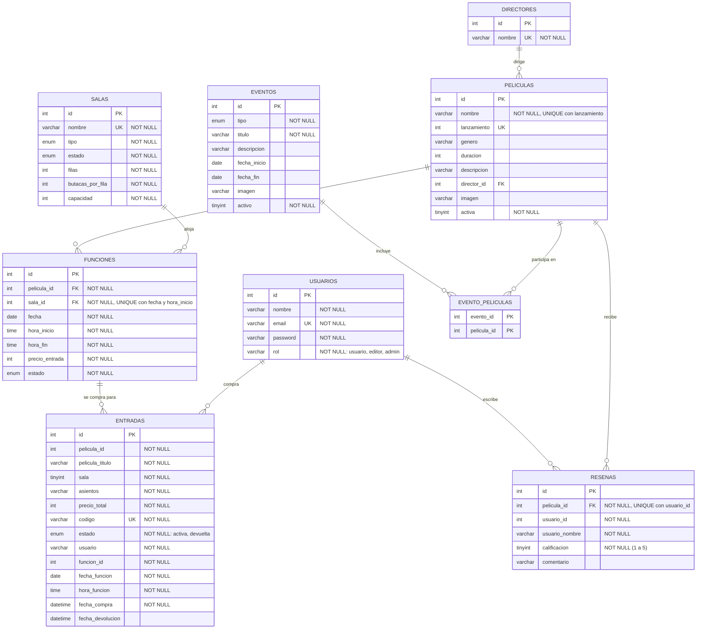

# Documentación del sistema

Última actualización: 24/10/2026

## 1. El sistema
- Nombre: CineSystem
- Qué problema resuelve: mostrar la cartelera de un cine y permitir comprar entradas eligiendo función y butacas, con un panel para administrar todo.
- Usuarios (tres roles, todos en la tabla `usuarios`, columna `rol`):

| rol | qué hace |
|---|---|
| `usuario` | ve la cartelera, compra entradas, ve "Mis entradas" y las devuelve antes de la función |
| `editor` | gestiona el catálogo desde el panel: películas, salas, funciones y eventos |
| `admin` | todo lo del editor + entradas y pagos, devoluciones por código, reportes y cuentas de usuario |

## 2. Qué cambió respecto de la versión vieja
Se comparó la versión vieja (`workspace_1.zip`, historial git hasta el commit `e81eb52`, solo cartelera + ficha de películas) con la versión actual.

| | versión vieja | versión actual |
|---|---|---|
| Datos | solo `peliculas` (+ `directores` en el SQL) | 9 tablas: directores, peliculas, usuarios, salas, funciones, entradas, eventos, evento_peliculas, resenas |
| Cuentas | `usuarios` y `admins` separadas | una sola tabla `usuarios` con `rol` (usuario / editor / admin) |
| Panel | no existía | panel admin/editor con menú lateral izquierdo (`admin/` + `includes/header-admin.php`) |
| Compra | no existía | función (fecha + hora + sala) → butacas → pago → código de entrada |
| Butacas | no existían | todas libres por defecto; se ocupan solo con entradas activas |
| Devoluciones | no existían | el usuario la hace desde "Mis entradas" escribiendo el código, solo antes de que empiece la función; el admin también puede por código |
| Cartelera | lista de películas | además muestra eventos y, debajo de cada uno, las funciones disponibles |
| Formularios | sin validación | guardia arriba, validación en PHP con avisos en castellano, la misma validación en el navegador y reglas `NOT NULL` / `UNIQUE` en la base |
| Archivos | `procesar_pelicula.php`, `procesar-login.php` sueltos y copias `(2)` | carpeta `procesar/`, `admin/`, `includes/`, `js/`, `tests/`, `docs/`; sin copias duplicadas |

## 3. Base de datos

### 3.1 Diagrama
El script completo está en `db.sql` (esquema + datos de prueba). El diagrama de abajo es el de la base actual. (`docs/modelo-er.jpeg` es el diseño inicial: tenía `admins` y `asientos`, que ya no existen.)



Notas del diagrama: `entradas` guarda una copia del título y el nombre del usuario a propósito, sin clave foránea, para que borrar una película o una función no borre lo que ya se vendió. `UK` con "UNIQUE con..." indica una restricción compuesta.

### 3.2 Reglas que aplica la base (`NOT NULL` y `UNIQUE`)
| tabla | regla | restricción |
|---|---|---|
| usuarios | dos cuentas no pueden tener el mismo email | `UNIQUE (email)` |
| directores | un director no se carga dos veces | `UNIQUE (nombre)` |
| peliculas | no hay dos películas con el mismo título y año | `UNIQUE (nombre, lanzamiento)` |
| salas | no hay dos salas con el mismo nombre | `UNIQUE (nombre)` |
| funciones | una sala no tiene dos funciones que arranquen el mismo día a la misma hora | `UNIQUE (sala_id, fecha, hora_inicio)` |
| entradas | cada entrada tiene un código único | `UNIQUE (codigo)` |
| resenas | un usuario deja una sola reseña por película | `UNIQUE (pelicula_id, usuario_id)` |
| todas | los datos que la regla exige no pueden faltar (nombre, email, clave, fecha, hora, precio, usuario de la compra, etc.) | `NOT NULL` |

Opcionales a propósito (aceptan NULL): año, género, duración, sinopsis, director e imagen de la película; descripción, fechas e imagen del evento; comentario de la reseña; fecha de devolución de la entrada.

`conexion.php` crea las tablas que faltan y agrega los `UNIQUE` con `ALTER ... ADD UNIQUE INDEX IF NOT EXISTS`, así también valen en bases creadas antes. Si la base ya tiene filas repetidas, el índice no se puede crear y queda anotado en el log de errores de PHP.

## 4. Validaciones y guardias

### 4.1 Guardia arriba de cada página que escribe
Las primeras líneas de cada archivo que escribe en la base (carpeta `procesar/`, `compra-exitosa.php`, `devolver-entrada.php`, `admin/admin-devoluciones.php`) son siempre estas, antes de abrir la base:

```php
session_start();
require __DIR__ . '/../includes/auth.php';
requiereGestion();                              // quién: admin o editor (o requiereAdmin / requiereLogin + bloquearAdmin)
requierePost('../admin/admin-peliculas.php');   // cómo: solo POST; si llega por GET, vuelve a la lista sin tocar nada
```

| guardia (en `includes/auth.php`) | qué rechaza |
|---|---|
| `requiereLogin()` | sin sesión iniciada → login |
| `requiereAdmin()` | cualquier rol que no sea admin |
| `requiereGestion()` | cualquier rol que no sea admin o editor |
| `bloquearAdmin()` | admin/editor en páginas de compra (son solo para usuarios) |
| `requierePost()` | entrar por la barra de direcciones (GET) |

El login y el registro son públicos: tienen solo la guardia de método.

### 4.2 Validación en PHP
- **Las reglas están en un solo lugar:** `includes/reglas.php` (una lista de campos por formulario).
- **Quien las aplica:** `includes/validar.php` (`validarFormulario`). Rechaza campo vacío, tipo equivocado (texto donde va un número, un array mandado a mano), valor fuera de rango, largo excesivo, formato inválido, opción que no existe, contraseñas distintas y hora/fecha de fin anterior a la de inicio, **siempre con el motivo**.
- **Aviso en castellano:** si algo falla, `rechazar()` guarda los avisos en la sesión y vuelve al formulario, que los muestra una vez en una caja roja y conserva lo que el usuario había escrito (nunca contraseñas ni datos de tarjeta).
- **Reglas que necesitan la base:** que el elemento exista, que no esté repetido (película, sala, función, email), que la sala esté disponible, que no se elimine algo en uso, que quede al menos un administrador.
- **Si la base igual rechaza** (carrera entre dos usuarios, dato demasiado largo), `ejecutarORechazar()` traduce el error de MySQL (1062 repetido, 1048 falta un dato, 1406 demasiado largo) a un aviso en castellano.

Ejemplos de avisos:
- «Completá el campo «Título».»
- «El campo «Duración (minutos)» tiene que estar entre 1 y 600.»
- «El campo «Año de lanzamiento» tiene que ser un número entero.»
- «La hora de finalización debe ser posterior a la hora de inicio.»
- «Ya existe una cuenta registrada con ese email.»

### 4.3 Validación en el navegador (mismos textos)
- Cada `<form>` lleva `novalidate data-reglas="..."`: `novalidate` apaga los globitos del navegador (otro idioma y otras palabras) y `data-reglas` trae las reglas **con los textos ya armados por el PHP**.
- `js/validar-formulario.js` aplica esas reglas al enviar, muestra el aviso debajo del campo y no envía si hay errores. No tiene ningún texto propio, así que el aviso es idéntico al del servidor por construcción.
- La validación del navegador es una comodidad: el PHP vuelve a validar todo, porque nada impide mandar un POST a mano.

### 4.4 Qué validan los formularios
| formulario | página | procesador |
|---|---|---|
| login | `index.php` | `procesar/procesar-login.php` |
| registro | `registro.php` | `procesar/procesar-registro.php` |
| usuario (admin) | `admin/admin-usuario-form.php` | `procesar/procesar_usuario.php` |
| película | `admin/admin-pelicula-form.php` | `procesar/procesar_pelicula.php` |
| sala | `admin/admin-sala-form.php` | `procesar/procesar_sala.php` |
| función | `admin/admin-funcion-form.php` | `procesar/procesar_funcion.php` |
| evento | `admin/admin-evento-form.php` | `procesar/procesar_evento.php` |
| ciclo de funciones | `admin/admin-evento-funciones.php` | `procesar/procesar_ciclo.php` |
| pago | `pago.php` | `compra-exitosa.php` |
| devolución (usuario) | `info.php` | `devolver-entrada.php` |
| devolución (admin) | `admin/admin-devoluciones.php` | la misma página |
| reseña | (sin pantalla por ahora) | `procesar/procesar_resena.php` |

Además, las acciones de las tablas (activar/desactivar, eliminar, cambiar rol) validan que el `id` sea un número positivo y que exista.

## 5. Archivos del proyecto
| archivo | para qué sirve |
|---|---|
| `index.php`, `registro.php`, `logout.php` | login, alta de cuenta y salida |
| `cartelera.php` | cartelera con eventos y, bajo cada evento, sus funciones disponibles |
| `pelicula.php`, `info.php` | ficha de película y "Mis entradas" (con devolución por código) |
| `seleccionar-funcion.php`, `asientos.php`, `pago.php`, `compra-exitosa.php` | compra: función → butacas → pago → código |
| `devolver-entrada.php` | procesa la devolución del usuario |
| `datos.php`, `entradas.php`, `salas-funciones.php`, `eventos-funciones.php`, `resenas-funciones.php` | datos y funciones de apoyo |
| `conexion.php` | conexión, tablas y reglas `UNIQUE` |
| `db.sql` | esquema completo + datos de prueba |
| `includes/` | `auth.php` (guardias), `reglas.php` y `validar.php` (validación), cabeceras y pie |
| `js/validar-formulario.js` | validación del navegador |
| `procesar/` | procesadores de formularios (los que escriben en la base) |
| `admin/` | panel admin/editor |
| `tests/validar-formulario.test.js` | pruebas automáticas de la validación del navegador |
| `docs/plan-de-pruebas.md` | plan de pruebas con casos negativos |

## 6. Mapa del flujo
```
login/registro -> sesión -> cartelera (películas + eventos con sus funciones)
  -> película -> elegir función -> elegir butacas -> pago (tarjeta validada)
  -> compra confirmada (código de entrada) -> Mis entradas -> devolver (código, antes de la función)

login admin/editor -> panel (menú lateral) -> películas / salas / funciones / eventos
  admin además: entradas y pagos / devoluciones / reportes / usuarios
```

## 7. Pruebas
Ver `docs/plan-de-pruebas.md`: casos positivos y negativos por pantalla, con el aviso esperado y la fecha. La validación del navegador se prueba sola con `node tests/validar-formulario.test.js`.

## 8. Git: ramas y merges
- Rama `feature/validaciones` (guardias, validación, reglas en la base): 3 commits, mergeada a `main` con `git merge --no-ff` y borrada con `git branch -d`.
- Rama `docs/plan-de-pruebas` (esta documentación y el plan de pruebas): mergeada a `main` y borrada con `git branch -d`.
- Con `git log --oneline --graph` se ven los dos merges.

## 9. Estado actual
- [x] Login + sesión + protección por rol
- [x] Includes + navegación (menú lateral en el panel)
- [x] Cartelera con eventos y funciones disponibles
- [x] Base MySQL conectada (9 tablas) con relaciones
- [x] Salas, funciones, eventos y compra de entradas con butacas
- [x] Devolución de entradas (usuario y admin) solo antes de la función
- [x] Guardias, validación PHP, validación en el navegador y reglas `NOT NULL` / `UNIQUE`
- [x] Plan de pruebas con casos negativos

## 10. Pendiente conocido
- `procesar/procesar_ciclo.php` inserta una columna `evento_id` en `funciones` que la tabla no tiene (ni `db.sql` ni `conexion.php` la crean), así que programar un ciclo de un evento no llega a crear funciones. No se tocó en esta etapa; hay que agregar la columna o sacar el campo del INSERT.
- Ejecutar el plan de pruebas de PHP y de la base en el servidor local (XAMPP) y completar las columnas de resultado.
- La pantalla de reseñas no está enlazada desde `pelicula.php`.
